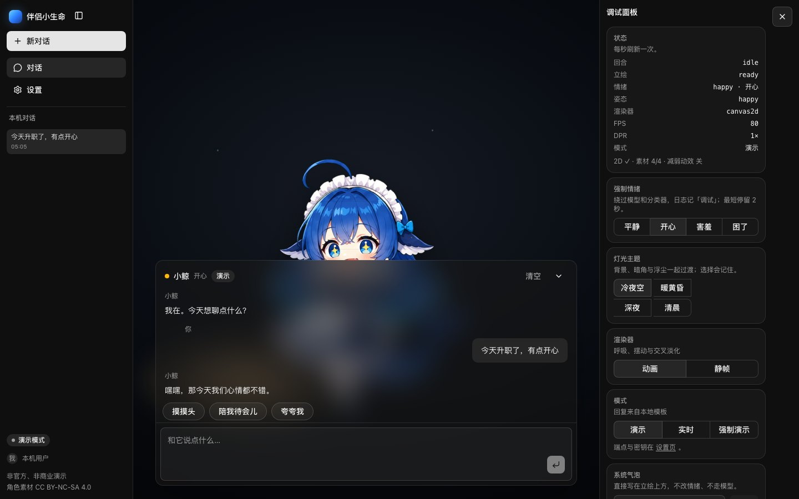
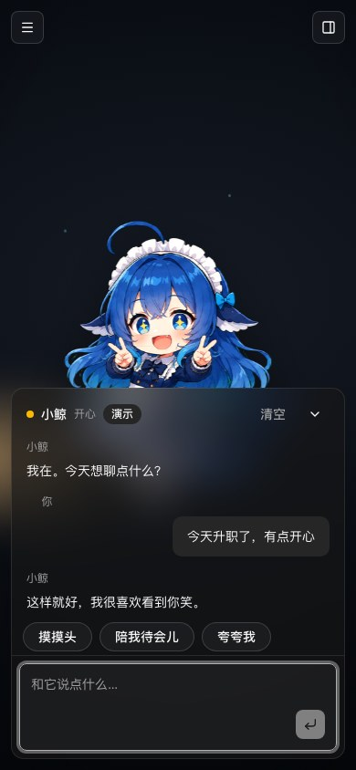
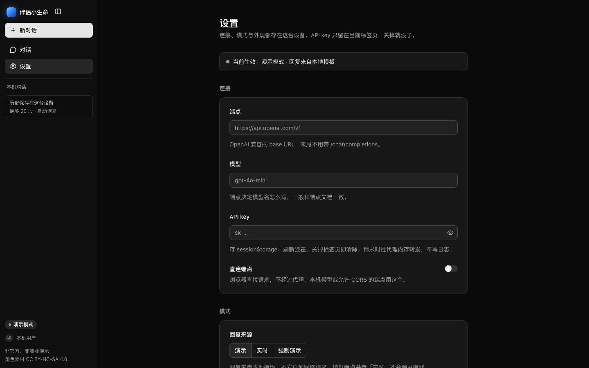

# Partner

[](https://github.com/Preference-cmd/web-partner/actions/workflows/ci.yml)
[](LICENSE)

**伴侣小生命** — a local-first AI companion demo. A drawn character, 小鲸,
stands on a dark stage; a chat panel floats in front of her. It answers from local templates
by default; point it at an OpenAI-compatible endpoint in settings and switch to
live mode to talk to your own model. Conversations, settings and the key stay in
the browser.

[**Live demo**](https://partner-web.sq103832.workers.dev) · [Getting started](#getting-started) · [Bring your own model](#bring-your-own-model) · [Deploying](#deploying) · [License](#license)


No sign-up, no server-side history, no analytics. The Worker serves the static
build and, when asked, proxies one model call.

## Features

### A character that reacts

- Four 512×512 poses — idle, happy, shy and sleepy — drawn on a Canvas 2D
  canvas.
- The reply picks the mood. The figure breathes in 28 slices, sways 0.6° around
  its feet, holds each mood for two seconds and crossfades in 350 ms.
- Reduced motion freezes the animation, the loop stops while the tab is hidden,
  and the device pixel ratio is capped at 2.
- The debug drawer can switch between the animated canvas and a single still
  frame.

### A chat that works before setup

- Demo replies stream from local templates, and three quick actions answer
  without a model.
- In demo mode a small keyword classifier picks the mood. A live reply can carry
  an `EMOTION:` first line; without one the same classifier decides.
- A live request that fails before any text arrives, or returns an empty
  stream, falls back to a template reply and is labelled `模板回复`.

### Bring your own model

- Any OpenAI-compatible base URL and model name.
- By default the turn goes to `POST /api/chat` and the Worker forwards it.
  Direct mode sends it from the browser instead, for a local model or an
  endpoint that allows CORS.
- The key lives in `sessionStorage` and is never written to a log.

### Twenty conversations on this device

- Up to 20 sessions of 100 messages, each titled from the first line.
- Start, switch, rename inline, and delete with a confirmation.
- The old single-conversation record, `partner.chat.v1`, is migrated once.

### Settings and a debug drawer

- `/settings` holds the connection, the mode with the reason it is active, the
  panel opacity (0.4–0.9) and the motion preference.
- The drawer shows the turn, pose, renderer, FPS, DPR and mode, keeps the last
  50 log lines, and can force a mood, switch the renderer, change the stage
  lighting and print a line above the character.



### Small things

- `Cmd/Ctrl+K` or `/` focuses the composer.
- Destructive actions use a dialog, not `window.confirm`.
- The sidebar and the debug drawer become sheets on phones.



## How it works

```text
browser
├─ Astro static shell + React islands
│  ├─ chat ──── POST /api/chat ──> Worker (partner-web) ──> your endpoint
│  └─ direct mode ─────────────────────────────────────────> your endpoint
├─ localStorage      conversations, settings, panel preferences
└─ sessionStorage    the API key
```

`apps/web` is an **Astro 7** app on the Cloudflare adapter. Pages ship as
static HTML; the sidebar, chat, settings and debug drawer hydrate as **React 19**
islands styled with **Tailwind 4** and **shadcn/ui**, with **AI Elements**
components for the conversation surface. The character is plain **Canvas 2D**,
no WebGL. State is a **Zustand** store, the pure modules are tested with
**Vitest**, and the deployable unit is the single Worker `partner-web`.

### The proxy

`POST /api/chat` accepts a JSON body and streams plain text back. It is
deliberately narrow:

| limit | value |
| --- | --- |
| request body | 32 KB |
| messages per request | 21 |
| one message | 2 KB |
| output | 120 tokens at temperature 0.7 |
| upstream timeouts | 8 s to the first chunk, 30 s idle |

The endpoint must be `https` with no credentials, query or fragment, and a
public host: `localhost`, IP literals, `.local`, `.internal` and
`.home.arpa` are rejected. Cross-origin browser callers are rejected too. The
Worker never logs the key or the prompt.

The model receives a short system prompt, the latest 20 messages and at most
6,000 characters of conversation.

### What stays in the browser

| key | contents |
| --- | --- |
| `partner.sessions.v1` | session index: active id, titles, timestamps |
| `partner.session.<id>.v1` | one transcript and its interrupted-reply marker |
| `partner.settings.v1` | endpoint, model, mode, direct switch, panel opacity, motion |
| `partner.secret.v1` | the API key, in `sessionStorage` — gone when the tab closes |
| `partner.panel.v1` | debug drawer: open state, light theme, renderer |

A legacy `partner.chat.v1` is read once, migrated into a session and
removed; a record that only holds the greeting is dropped.

## Getting started

Node 24 (`.nvmrc`) and pnpm 10.30.3 (`packageManager`) are required.

```bash
pnpm install     # dependencies and git hooks
pnpm dev         # http://localhost:4321
pnpm check       # lint, typecheck, test, build — the full gate
```

`pnpm dev` runs `astro dev` through the Cloudflare adapter, so the app uses
the Workers runtime (`workerd`) in development too, including `/api/chat`.

## Bring your own model

1. Open `/settings`.
2. Enter the base URL without `/chat/completions`, the model name and the key.
3. Switch the mode to 实时. If the endpoint is local `http` or does not allow
   CORS, turn on 直连端点 so the browser calls it directly.

The sidebar chip names the mode in force: 演示模式 when a template answers,
实时模式 when the model does. Closing the tab drops the key; “清除当前标签页里
的 API key” removes it immediately. A failed upstream falls back to a labelled
template reply.



## Deploying

**Actions → Deploy → Run workflow** is the only deploy path. It checks the app,
builds it and uploads `apps/web` as the Worker `partner-web`.

- The repository secret `CLOUDFLARE_API_TOKEN` is required.
- `CLOUDFLARE_ACCOUNT_ID` is optional and only needed when the token can see
  more than one account.
- The demo runs at <https://partner-web.sq103832.workers.dev>.

A release is ready when `pnpm check` passes and the deployed Worker serves
`/` and `/settings/` with 200, the character art as `image/webp`, and
rejects an empty `POST /api/chat` with 400. `wrangler rollback` returns to
the previous version. The build and environment rules are in
[`AGENTS.md`](AGENTS.md).

## Repository

```text
apps/web/     the app: Astro pages, React islands, Canvas character, Worker route
docs/         screenshots used by this README
scripts/      repository helpers (git hook installer)
.github/      CI, manual deploy, Dependabot
```

`packages/*` is part of the pnpm workspace for code shared between apps;
nothing lives there yet.

## License

The code is **MIT** — see [`LICENSE`](LICENSE). The character art in
`apps/web/public/character/` is not covered by that licence: it is
**CC BY-NC-SA 4.0**, non-commercial and share-alike. [`NOTICE.md`](NOTICE.md)
records the boundary and
[`ATTRIBUTION.md`](apps/web/public/character/ATTRIBUTION.md) credits the
original artists. Replace the art before any commercial use; this demo is
unofficial and non-commercial.

## Working on it

Read [`AGENTS.md`](AGENTS.md) before the first change: layout, fact sources,
the commands CI runs, commit rules and the conventions. Hooks format and lint on
commit and typecheck and test on push; CI repeats the full gate.
