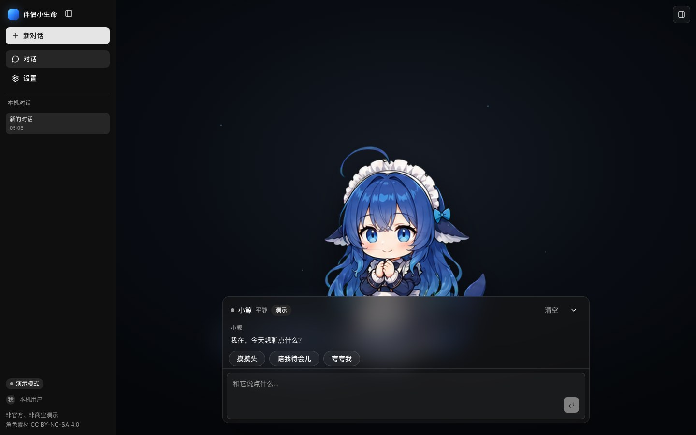

# Partner

[](https://github.com/Preference-cmd/web-partner/actions/workflows/ci.yml)
[](LICENSE)

**伴侣小生命** — a local-first AI companion demo. A drawn character, 小鲸, stands
on a dark stage; a chat panel floats in front of her. It answers from local
templates by default; add a provider — a base URL, a key and a few model names —
and switch to live mode to talk to your own model. Conversations, settings and
the keys stay in the browser.

[**Live demo**](https://partner-web.sq103832.workers.dev) · [Getting started](#getting-started) · [Bring your own model](#bring-your-own-model) · [Deploying](#deploying) · [License](#license)



[Watch the character demo](docs/demo-character.mp4) (27 s, no audio): a head pat,
the collapsed stage, a jump, a shy beat, a doze and the final frame list.

## Features

- **A character that reacts.** Six frame sequences (idle, waving, jumping,
  failed, waiting, review) play on a Canvas 2D canvas: she blinks and swings her
  tail while calm, waves when the stage opens or she is patted, jumps once and
  keeps the smile while happy, looks down while shy, dozes while sleepy, and
  waits while a reply is in flight. The mood owns the pose until it changes.
  A fallback reply gets a failed take. Reduced motion holds one frame. She is
  also a button: a
  tap is a head pat, a held press or Enter says a line, and each reply drops its
  first sentence onto the stage (switchable in 外观).
- **Chat that works before setup.** Demo replies stream from local templates,
  and three quick actions answer without a model.
- **Bring your own model.** A provider is one OpenAI-compatible base URL, a key
  and up to eight model names; add up to eight of them and the composer's model
  menu groups the models by provider. Each provider lists the thinking levels it
  accepts (最低, 低, 中, 高), so the 努力 menu only offers what that endpoint
  understands — sent as `reasoning_effort`, off by default, so a plain model
  never receives the field. Requests go through the Worker, or straight from the
  browser for a local model.
- **Attachments without a server.** Up to four images (1 MB each) or plain
  text files (64 KB each) per message; they are sent inline with that turn and
  never stored, so a reloaded conversation shows the filename marked 已过期.
- **Twenty conversations on this device.** Up to 20 sessions of 100 messages are
  kept in the browser, with switch, inline rename, delete and a one-time
  migration from `partner.chat.v1`.
- **Settings with a map.** One dialog, a 供应商 list on the left rail and four
  sections beside it: 供应商, 对话与调用, 外观, 数据 (the version rows sit at the
  end of 数据). They switch one at a time — by click, or with arrows, Home and
  End — with the live/demo status kept above the panel. Adding a provider opens
  a second dialog — name, protocol, base URL, proxy or direct, key, models and
  the enabled thinking levels — where 验证并保存 sends one ping before it saves.
  Appearance owns opacity, the reply echo, the four stage lights and motion. The
  debug drawer keeps the pose, FPS, log lines and forced moods, plus its own
  light switch.
- **Details that matter.** `Cmd/Ctrl+K` or `/` focuses the composer,
  destructive actions ask in dialogs, the layout becomes sheets on phones, and
  every control a thumb needs is at least 44×44 there. On phones the composer's
  bottom row keeps only the attachment and send controls; model and effort move
  to a row above the input, and the quick actions fold behind 更多.

## How it works

`apps/web` is an Astro 7 app on the Cloudflare adapter: static pages, React 19
islands on Tailwind 4 and shadcn/ui, a Canvas 2D character and a Zustand chat
controller. `POST /api/chat` streams from your endpoint through the Worker, or
the browser calls it directly in direct mode. Nothing is stored on the server,
and there is no analytics.

## Getting started

Node 24 (`.nvmrc`) and pnpm 12.18.0 are required.

```bash
pnpm install     # dependencies and git hooks
pnpm dev         # http://localhost:4321
pnpm check       # lint, typecheck, test, build
```

`pnpm dev` serves the app on the Workers runtime, including `/api/chat`.

## Bring your own model

1. Open the settings dialog: sidebar → 设置, or `/?settings=1`. Each section has
   its own link, so `/?settings=1#providers` opens on the supplier list; older
   links such as `#about` land on the section that owns them now.
2. 供应商 → 添加供应商: a name (or leave it empty and the host is used), the base
   URL without `/chat/completions`, the key, and one model name per row. Pick
   经代理 to send through the Worker, or 浏览器直连 for a local `http` endpoint or
   one that does not allow CORS.
3. 启用的思考强度: tick the levels this endpoint accepts. The composer's 努力 menu
   then offers 关 plus exactly those levels.
4. 验证并保存 sends one ping with the values still on screen and reports 通过,
   key 被拒 or 端点不可达; a failed test can still be saved with 仍然保存.
5. 对话与调用: switch to 实时, and set the output budget, context window and the
   thinking level in force. The output budget stays a separate number: a
   reasoning model spends it while it thinks, so raise it when answers stop
   mid-sentence.

The sidebar chip names the mode in force. Each provider's key lives in
`sessionStorage` and is gone when the tab closes; a failed upstream falls back to
a labelled template reply. A settings file from before providers existed is read
as one provider named after its host, and its single key keeps working.

## Deploying

**Actions → Deploy → Run workflow** builds `apps/web` and uploads it as the
Worker `partner-web`. The repository secret `CLOUDFLARE_API_TOKEN` is required;
`CLOUDFLARE_ACCOUNT_ID` is optional and only needed when the token can see more
than one account. The demo runs at
<https://partner-web.sq103832.workers.dev>.

A release is ready when `pnpm check` passes and the deployed Worker serves `/`
with 200 and `/settings/` as a redirect stub. `wrangler rollback` returns to the
previous version.

## License

The code is MIT (see [`LICENSE`](LICENSE)). The character art is separate: the
six frame sequences are cropped from
[codex-pet-DeepSeek-girl](https://github.com/xpy12367/codex-pet-DeepSeek-girl) by
xpy12367, a repository that carries no license. This project claims no ownership
of those frames and permits no commercial use of them; they appear only in this
non-commercial demo. The character is by 上善无形, and the earlier stills came
from [dsh-whale-musume](https://github.com/Sutera-Diffusus/dsh-whale-musume)
under CC BY-NC-SA 4.0. See [`NOTICE.md`](NOTICE.md) and
[`ATTRIBUTION.md`](apps/web/public/character/ATTRIBUTION.md). The preview in
`docs/` shows the art and carries the same terms; replace the art before any
commercial use.
